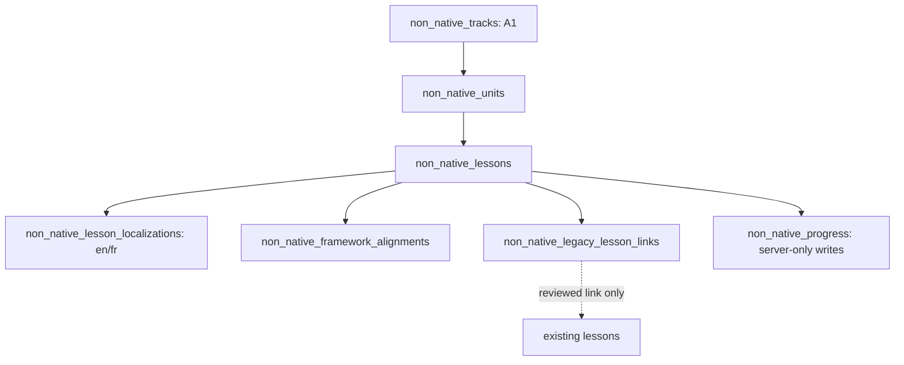

# ضاديوم العالمية — مرحلة A1 Alpha
**الحالة:** تصميم تنفيذي ومخطط محتوى، وليس محتوى منشورًا أو ترحيلًا منفذًا.  
**تاريخ المرجع:** 2026-11-06. **المستودع:** `mrahmedsamirhamam-ui/dadyoom` فقط.

## 1. تدقيق الموجود قبل البناء
- قاعدة الإنتاج تحتوي جداول `curricula` و`grades` و`units` و`lessons`، و`lesson_learning_objectives`. تخدم بنية المناهج الحالية؛ لا تغيير أو حذف فيها.
- `app/(dashboard)/courses/rooms/non-native/page.tsx` يقدم غرفة وموارد لغير الناطقين، لكنها ليست إثباتًا لنشر CEFR A1–C2.
- `lib/level-check/assessment.ts` اختبار توجه عام للغة العربية، وليس أداة قياس CEFR مرخصة أو محققة.
- مكتبة المهارات تضم القراءة والكتابة والاستماع والتحدث؛ يمكن استخدام مكوناتها عند اجتياز اختبارها.
- لا يجوز افتراض صلاحية أي من >8,400 درس للتعلم الثاني؛ الربط عبر `non_native_legacy_lesson_links` يحتاج مطابقة ومراجعة بشرية.

## 2. المرجع الأكاديمي والحقوق
- CEFR: https://www.coe.int/en/web/common-european-framework-reference-languages/cefr-descriptors
- Cambridge IGCSE Arabic FIRST Language `0508`: https://www.cambridgeinternational.org/programmes-and-qualifications/cambridge-igcse-arabic-first-language-0508/
- Cambridge IGCSE Arabic FOREIGN Language `0544`: https://www.cambridgeinternational.org/programmes-and-qualifications/view/cambridge-igcse-arabic-foreign-language-0544/
- IB DP Language B: https://ibo.org/university-admission/latest-curriculum-updates/language-b-updates/
- Cambridge 0544 foreign language ليس مساويًا لمستوى A1؛ تشير Cambridge إلى كفاءة حتى A2 وبعض B1. ولا تستخدم 0508 بوصفها عربية أجنبية.
- مواد ومفردات وأمثلة هذه الحزمة مكتوبة أصلًا؛ الروابط أعلاه مرجع تنظيمي فقط. لا تنسخ امتحانات أو كتبًا مرخصة، ولا توحي بشراكة أو اعتماد رسمي.

## 3. النموذج التقني دون كسر المناهج الوطنية
الملف `docs/international/PROPOSED_NON_NATIVE_SCHEMA.sql` **مسودة تصميم فقط** خارج مجلد migrations، ولا يُطبَّق مباشرة على الإنتاج.

- `title_ar` و`title_en`: حقول أساسية متاحة للواجهات ثنائية اللغة.
- `instruction_language`: `en` أولًا و`fr` لاحقًا. الشروح لا توضع في عمود جديد لكل لغة؛ فجدول localizations يحتوي (`lesson_id`, `instruction_language`, `explanation`, `worked_example`). شرح الإنجليزية يعادل صف اللغة `en`، لا ادعاء بوجود `explanation_en` فعلي حاليًا.
- `interface_language` خاص بلغة القوائم والتصفح، وقد يختلف عن لغة شرح الدرس. يجب أن تكون النصوص العربية RTL والإنجليزية والفرنسية LTR، مع `dir=auto` عند عرض النص المختلط.
- الجداول الوطنية لا تُمس؛ الارتباط بالمحتوى الموجود يتم فقط عبر جدول ربط قابل للمراجعة مع تحديد المهارة والهدف والحقوق.
- إعدادات التقدم تُكتب من الخادم بعد تصحيح وإثبات مناسب؛ لا يكون فتح الصفحة أو إجابة وحيدة دليل إتقان.
- حماية RLS على الجداول السبعة، القراءة العامة للمحتوى المنشور والمراجع فقط، ولا يوجد منح كتابة للعميل. اختبار RLS بصلاحيات anon وauthenticated وservice_role في قاعدة استنساخ شرط قبل أي تطبيق.

## 4. خريطة A1 — 12 وحدة و48 درسًا مخططًا
المرجع القابل للقراءة آليًا: `data/international/a1-curriculum-draft.json`. كل عنوان معه هدف مرصود بالعربية والإنجليزية، ومهارة أساسية. **هذه مخططات أصلية تحتاج إنتاجًا ومراجعة، وليست 48 درسًا تعليميًا مكتملًا.**

| الوحدة | المحور | عدد الدروس | الموجة |
|---|---|---:|---|
| 01 | الحروف والأصوات | 4 | Alpha |
| 02 | التحية والتعارف | 4 | Alpha |
| 03 | أنا وهويتي | 4 | Alpha |
| 04 | أسرتي وأصدقائي | 4 | Alpha |
| 05 | الأعداد والمواعيد | 4 | لاحقة |
| 06 | في الصف والبيت | 4 | لاحقة |
| 07 | الطعام والشراب | 4 | لاحقة |
| 08 | التسوق والألوان | 4 | لاحقة |
| 09 | يومي المعتاد | 4 | لاحقة |
| 10 | المدينة والاتجاهات | 4 | لاحقة |
| 11 | الصحة والطقس | 4 | لاحقة |
| 12 | رحلتي الأولى بالعربية | 4 | لاحقة |

**نطاق Alpha: 16 مخطط درس، وليس 16 درسًا منشورًا.** كل درس مكتمل لاحقًا يحتاج شرحًا قصيرًا، مثالًا محلولًا، بطاقات أصلية، استماعًا صوتيًا مرخصًا، تطبيقًا موجهًا، سؤال تحقق مستقلًا، تلميحات، شرح أخطاء، ومراجعة مؤجلة.

## 5. مثال تعليمي مفصل: A1-U02-L02 «أسأل عن الاسم»
- **المهارة:** تفاعل شفهي، ويمكن السماح بإجابة مكتوبة في التجربة الأولية.
- **الهدف القابل للملاحظة:** يسأل عن اسم شخص ويجيب عن اسمه في تبادل قصير.
- **المدخل:** `ما اسمك؟` / `اسمي سارة.`؛ English: "What is your name? / My name is Sara." أمثلة أصلية.
- **المثال المحلول:** شخص يقول «مرحبًا. ما اسمك؟» ويرد الآخر «اسمي مازن». يوضح المساعد دور السؤال والجواب.
- **بطاقتان موجَّهتان:** ربط صوت التحية بعبارتها؛ وترتيب كلمات سؤال الاسم بصورة سليمة.
- **التطبيق:** متعلم يختار سؤالًا مناسبًا عند مشاهدة صورة لقاء أول.
- **التحقق المستقل:** لقاء مختلف مع اسم جديد، دون تكرار أمثلة التدريب أو نسخ سؤالها.
- **تفسير الخطأ:** يوضح الفرق بين سؤال الاسم وجواب الاسم.
- **الخطوة التالية:** تقديم النفس بالاسم والبلد ثم مراجعة بعد يوم وأسبوع وثلاثة أسابيع، على أن تُضبط الفترات بالتجربة.
- **حدود الإثبات:** الإجابات النصية وحدها تثبت فهم التعبير، لا كفاءة التحدث الصوتي أو إتقان مستوى A1.

## 6. الصوت ومخارج الحروف
- فرّق بين تدريب **الاستماع والتمييز** (يمكن اختباره بالاختيار) وتدريب **إنتاج الصوت** (لا تمنحه درجة نطق آلية موثوقة قبل دراسة صدق القياس).
- الأمثلة الأولى: `ح/هـ` و`ق/ك`. يجب تسجيل صوت بشري واضح بلهجة معيارية أو مصادر مرخصة، وتجريب الفروق على مستويات عدة ومن متحدثين غير أصليين.
- في Alpha: الصوت للاستماع أو تمرين اختياري فقط؛ لا تخزين لتسجيلات خام أو بصمات صوتية؛ لا إرسال لمزود خارجي جديد دون إذن.
- إن ظهرت لاحقًا خدمة تعرف صوتي، نحتاج موافقة المستخدم والخصوصية، واختبارات اللهجات والتحيز والدقة، ومراجعة بشرية عند القرارات المؤثرة.

## 7. بوابات العمل قبل إظهار المسار للمتعلمين
1. **محتوى:** 100% من دروس Alpha المراد نشرها تحتوي أهدافًا قابلة للملاحظة، أمثلة أصلية، تقويمًا جديدًا ومفاتيح لا تظهر في الاستجابات العامة.
2. **حقوق ومراجعة:** مراجعة لغوية وتربوية وحقوق وإتاحة لكل درس Alpha؛ مراجعة ترجمات الإنجليزية وفق السياق، ثم الفرنسية عند جاهزيتها.
3. **أمن:** اختبار معزول لـRLS، عدم كشف بيانات الأطفال، صلاحيات الدرجات والتقدم من الخادم، حدود معدلات الاستدعاء، وعدم استحداث تخزين صوت.
4. **تجربة:** RTL/LTR على الجوال، لوحة مفاتيح وقارئ شاشة، تنزيل مناسب للشبكات الضعيفة، اختبار دون تسجيل، طلب الحساب فقط لحفظ التقدم.
5. **تعلم:** اختباران مختلفان (تمرين موجَّه ثم تحقق) ومراجعة لاحقة؛ لا نسمي نتيجة عينة صغيرة `CEFR certified`.
6. **Alpha:** مقابلات وتجربة حقيقية مع متعلمين موافقين، وتوثيق الأخطاء، ثم قرار go/no-go؛ لا اختلاق نسبة نجاح.

## 8. خطة تنفيذ Alpha مشروطة بالموارد
| فترة مقترحة | العمل | مخرج قابل للقياس |
|---|---|---|
| أسبوع 1 | اعتماد المخطط وحقوق البيانات ونوع الجمهور | 16 هدفًا متفقًا عليها؛ تصميم DB واجتياز فحوص الصياغة |
| أسبوع 2 | كتابة 8 دروس أولى أصلية وتسجيلات مسموحة | 8 دروس للمراجعة، لا نشر |
| أسبوع 3 | كتابة 8 دروس أخرى ومراجعة لغوية إنجليزية | 16 درسًا مع تمارين وتفسيرات |
| أسبوع 4 | اختبار المتصفح والصوت التمييزي وصلاحيات البيانات | تقرير اختبارات وتراجع في بيئة معزولة |
| أسبوع 5 | تجربة Alpha مغلقة ومقابلات مستخدمين | بيانات فعلية عن الفهم والعوائق دون معلومات خاصة زائدة |
| أسبوع 6 | إصلاح عيوب التجربة وإعادة المراجعة | قرار محدود بالنشر أو الاستمرار بالمسودة |

الجدول **تقدير** مشروط بوجود كاتب/مراجع لغة، ومراجع تعليم لغة ثانية، ومهندس/مختبر. لا يتم الانتقال إلى موجة جديدة قبل اجتياز الحالية. نقص الموارد أو عدم اكتمال المراجعة يؤخر النشر ولا يُسقط شرط الجودة.

## 9. التوسع اللاحق
**Phase 2:** بناء شبكة تجارب مع مدارس ومراكز لغة في أوروبا وأمريكا بعد ثبوت نتائج Alpha، من دون ادعاء تعاقد أو شراكة. تقاس جودة الاحتفاظ والقدرة التعليمية والتكلفة وتطابق الحقوق.

**Phase 3:** تجربة المحمول والتعلم دون اتصال ودعم اللغة الفرنسية، ثم تصميم اشتراكات دولية اختيارية *بعد موافقة المالك* واختبارات sandbox للإلغاء/الاسترداد/الرسوم. لا تغيير للدفع أو الأسعار في هذه الدفعة.

## 10. تسليم آمن
- المخطط والفهرس واختبارات التحقق موجودة على فرع مستقل، ولا دمج ولا ترحيل لقاعدة الإنتاج ولا بيانات طالب حقيقية.
- يتطلب النشر مستقبلاً: إنشاء migration عبر Supabase CLI على بيئة اختبار، نسخة احتياطية، RLS fixture، اختبارات تشغيل، مراجعة أكاديمية، خطة تراجع.
- إغلاق مخاطر P0 الحالية في المشروع الأساسي شرط إطلاق، بما فيها صلاحيات الحسابات والتقييم. لا تعني هذه الحزمة أنها عالجت تلك المشكلات.
